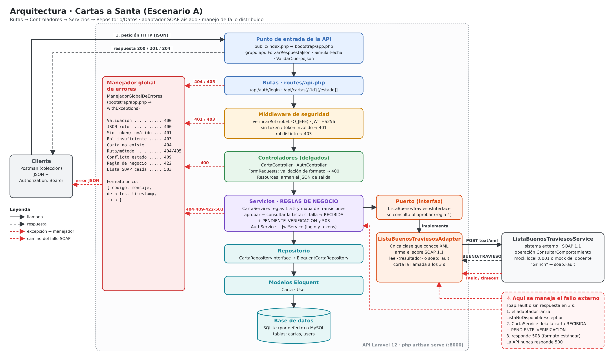

# Cartas a Santa · API del Taller (Escenario A)

Resolví el **Escenario A: Cartas a Santa y gestión de regalos**. Es una API REST en **Laravel 12** que registra las cartas, las mueve por su flujo (recibida → aprobada → en producción → entregada) y, antes de aprobar, consulta la **Lista de Buenos y Traviesos**, un servicio SOAP heredado que se cae cuando quiere. La API está pensada para eso: si la Lista falla o tarda más de 3 segundos, la carta queda en pausa y la respuesta es un 503 ordenado, nunca un 500.



El diagrama está en [`docs/arquitectura.png`](docs/arquitectura.png) y la versión editable en [`docs/arquitectura.drawio`](docs/arquitectura.drawio) (se abre con draw.io / diagrams.net).

---

## 1. Requisitos

- PHP **8.2 o superior** con las extensiones `pdo_sqlite` (o `pdo_mysql`), `mbstring`, `openssl`, `curl`, `dom`/`xml` y `fileinfo`
- Composer 2
- Postman (para la colección de evidencias)

No hace falta Node ni un servidor de base de datos: por defecto uso SQLite.

## 2. Cómo levantar el proyecto

```bash
composer install
composer setup
```

`composer setup` hace todo lo de una vez: copia `.env.example` a `.env`, genera `APP_KEY` y `JWT_SECRET`, crea `database/database.sqlite`, corre las migraciones y siembra los usuarios de prueba (más cinco cartas de ejemplo).

Después abro **dos terminales**:

```bash
# Terminal 1: mock local del servicio SOAP en http://127.0.0.1:8001
composer mock-soap

# Terminal 2: la API en http://127.0.0.1:8000
php artisan serve
```

Si prefieres hacerlo paso a paso (o `composer setup` falla en tu equipo):

```bash
cp .env.example .env            # en Windows: copy .env.example .env
php artisan key:generate
php artisan jwt:secret
php -r "touch('database/database.sqlite');"
php artisan migrate --seed
```

Pruebas automatizadas (66 pruebas, no necesitan el mock porque simulan el SOAP):

```bash
php artisan test
```

## 3. Variables de entorno

Todas están en `.env.example`. Ningún secreto está en el repositorio: `APP_KEY` y `JWT_SECRET` van vacíos y se generan en cada máquina.

| Variable | Para qué sirve | Valor en `.env.example` |
|---|---|---|
| `APP_KEY` | Clave de Laravel | vacío → `php artisan key:generate` |
| `APP_TIMEZONE` | Zona horaria para la regla del 24 de diciembre | `America/Guayaquil` |
| `DB_CONNECTION` | Motor de base de datos | `sqlite` (hay líneas comentadas para MySQL) |
| `JWT_SECRET` | Secreto para firmar los JWT (HS256) | vacío → `php artisan jwt:secret` |
| `JWT_TTL` | Vigencia del token en segundos | `7200` |
| `DEMO_PASSWORD` | Contraseña de los usuarios que crea el seeder | `Navidad2026` |
| `LISTA_SOAP_URL` | Endpoint del servicio SOAP | `http://127.0.0.1:8001/ListaBuenosTraviesosService` (mock local) |
| `LISTA_SOAP_NAMESPACE` | `targetNamespace` del WSDL (prefijo `pn:`) | `http://polonorte.beatlech/lista` |
| `LISTA_SOAP_ACTION` | `soapAction` de `ConsultarComportamiento` | `ConsultarComportamiento` |
| `LISTA_SOAP_TIMEOUT` | Segundos máximos de espera | `3` |
| `PERMITIR_FECHA_SIMULADA` | Habilita el header `X-Fecha-Simulada` (ver sección 6) | `true` |

**Para usar el mock del docente** cambio en el `.env` la URL por la de su WSDL (`soap:address location`) y ejecuto `php artisan config:clear`. El namespace ya viene igual al del enunciado (`http://polonorte.beatlech/lista`); si su WSDL trae otro `targetNamespace` o un `soapAction` distinto, también se cambian ahí. No hay que tocar código.

## 4. Usuarios y tokens de prueba

| Correo | Rol | Contraseña |
|---|---|---|
| `jefe@polonorte.test` | `ELFO_JEFE` | la de `DEMO_PASSWORD` (`Navidad2026`) |
| `elfo@polonorte.test` | `ELFO` | la de `DEMO_PASSWORD` (`Navidad2026`) |

Los tokens no se guardan en ningún archivo porque se firman con el `JWT_SECRET` de cada máquina. Se piden así:

```bash
curl -X POST http://127.0.0.1:8000/api/auth/login \
  -H "Content-Type: application/json" \
  -d '{"email":"jefe@polonorte.test","password":"Navidad2026"}'
```

La respuesta trae `data.token`, que va en el header `Authorization: Bearer <token>`. En la colección de Postman esto es automático: la carpeta `00 · Autenticación` guarda los tokens en variables.

## 5. Endpoints

| Método | Ruta | Seguridad | Respuestas |
|---|---|---|---|
| POST | `/api/auth/login` | pública | 200, 400, 401 |
| POST | `/api/cartas` | pública | 201, 400, 422 |
| GET | `/api/cartas?estado=&ciudad=` | pública | 200, 400 |
| GET | `/api/cartas/{id}` | pública | 200, 404 |
| PUT | `/api/cartas/{id}` | pública (solo si está `RECIBIDA`) | 200, 400, 404, 409 |
| DELETE | `/api/cartas/{id}` | rol `ELFO_JEFE` | 204, 401, 403, 404, 409 |
| PATCH | `/api/cartas/{id}/estado` | rol `ELFO_JEFE` | 200, 400, 401, 403, 404, 409, 503 |

Ejemplo de carta:

```json
{
  "remitente": "Valentina Pérez",
  "edad": 7,
  "ciudad": "Guayaquil",
  "regalos": ["Bicicleta", "Muñeca de trapo"]
}
```

El cliente solo manda esos cuatro campos. `id`, `estado`, `comportamiento` y `fechaRecepcion` los pone el sistema; si el cliente los envía, se ignoran (por eso una carta siempre nace `RECIBIDA`). `comportamiento` arranca en `null` porque todavía nadie consultó la Lista.

## 6. Reglas de negocio: dónde viven y qué responden

Todas están en `app/Services/CartaService.php`. Los controladores no deciden nada.

| Regla | Método | Respuesta si se viola |
|---|---|---|
| 1. No se aceptan cartas después del 24 de diciembre | `registrar()` | **422** `FUERA_DE_PLAZO` |
| 2. Toda carta nace `RECIBIDA` | `registrar()` | — |
| 3. Solo `RECIBIDA→APROBADA/RECHAZADA`, `APROBADA→EN_PRODUCCION`, `EN_PRODUCCION→ENTREGADA` | `cambiarEstado()` (constante `TRANSICIONES`) | **409** `TRANSICION_INVALIDA` |
| 4. Para aprobar se consulta el SOAP; si dice `TRAVIESO` pasa a `RECHAZADA` | `aprobarConsultandoLaLista()` | 200 con `estado: RECHAZADA` |
| 5. Una carta `ENTREGADA` no se modifica ni se elimina | `actualizar()`, `eliminar()` | **409** `CARTA_ENTREGADA` |
| PUT solo en `RECIBIDA` | `actualizar()` | **409** `CARTA_NO_EDITABLE` |

Usé 409 para todo lo que depende del estado actual de la carta y 422 para la regla de calendario, que no depende del estado.

**Cómo pruebo la regla del 24 de diciembre si hoy no es 25:** en desarrollo la API acepta el header `X-Fecha-Simulada` (por ejemplo `X-Fecha-Simulada: 2026-12-25`). Durante esa petición la aplicación trabaja con esa fecha. Solo funciona con `PERMITIR_FECHA_SIMULADA=true` y nunca con `APP_ENV=production`. Las pruebas automatizadas, en cambio, mueven el reloj con `travelTo()`.

## 7. Formato único de errores

Todo error sale del manejador global (`app/Exceptions/ManejadorGlobalDeErrores.php`, registrado en `bootstrap/app.php`) con la misma forma:

```json
{
  "codigo": "TRANSICION_INVALIDA",
  "mensaje": "No se puede pasar de ENTREGADA a RECIBIDA",
  "detalles": [
    { "estadoActual": "ENTREGADA", "estadoSolicitado": "RECIBIDA", "transicionesPermitidas": [] }
  ],
  "timestamp": "2026-12-01T15:15:00Z",
  "ruta": "/api/cartas/7/estado"
}
```

| HTTP | Códigos |
|---|---|
| 400 | `VALIDACION_FALLIDA` (detalle por campo), `JSON_MALFORMADO`, `FECHA_SIMULADA_INVALIDA` |
| 401 | `TOKEN_REQUERIDO`, `TOKEN_INVALIDO`, `TOKEN_EXPIRADO`, `CREDENCIALES_INVALIDAS` |
| 403 | `ROL_INSUFICIENTE` |
| 404 | `CARTA_NO_ENCONTRADA`, `RUTA_NO_ENCONTRADA` |
| 405 | `METODO_NO_PERMITIDO` |
| 409 | `TRANSICION_INVALIDA`, `CARTA_NO_EDITABLE`, `CARTA_ENTREGADA` |
| 422 | `FUERA_DE_PLAZO` |
| 503 | `SERVICIO_EXTERNO_NO_DISPONIBLE` |

## 8. Integración SOAP y manejo del fallo

`app/Integrations/Soap/ListaBuenosTraviesosAdapter.php` es la única clase que sabe que existe XML. Arma el sobre SOAP 1.1 de `ConsultarComportamiento` igual al del enunciado, lo envía por HTTP con un límite de **3 segundos** y traduce la respuesta a un enum de dominio (`Comportamiento::BUENO` o `Comportamiento::TRAVIESO`). El servicio de cartas solo conoce la interfaz `ListaBuenosTraviesosInterface`.

Si el SOAP responde un `soap:Fault`, no contesta a tiempo, rechaza la conexión o devuelve algo ilegible, el adaptador lanza `ListaNoDisponibleException`. `CartaService` la atrapa y hace lo que pide el escenario A:

1. la carta **se queda en `RECIBIDA`**,
2. su `comportamiento` pasa a **`PENDIENTE_VERIFICACION`**,
3. la API responde **503** con el formato estándar (y `Retry-After: 60`).

```json
{
  "codigo": "SERVICIO_EXTERNO_NO_DISPONIBLE",
  "mensaje": "La Lista de Buenos y Traviesos no está disponible. La carta 10 se mantiene en RECIBIDA con comportamiento PENDIENTE_VERIFICACION; intenta aprobarla más tarde.",
  "detalles": [{
    "servicio": "ListaBuenosTraviesosService",
    "motivo": "FAULT",
    "descripcion": "soap:Fault soap:Server: Lista en mantenimiento",
    "cartaId": 10,
    "estadoCarta": "RECIBIDA",
    "comportamiento": "PENDIENTE_VERIFICACION"
  }],
  "timestamp": "2026-11-24T02:32:19Z",
  "ruta": "/api/cartas/10/estado"
}
```

Cuando la Lista vuelve, se puede intentar aprobar la misma carta otra vez.

**Mock local** (`mock-soap/servidor.php`, solo para desarrollo):

| Nombre del remitente | Qué responde |
|---|---|
| `Grinch` | `soap:Fault` con `soap:Server` / "Lista en mantenimiento" (igual que el mock del docente) |
| `Krampus` | tarda 4 s → la API corta a los 3 s (`motivo: TIMEOUT`) |
| contiene "travies" (ej. `Pedro Travieso`) | `TRAVIESO` |
| cualquier otro | `BUENO` |

También se puede demostrar el fallo apagando el mock (Ctrl+C): la API responde 503 con `motivo: SIN_CONEXION`.

## 9. Arquitectura

Rutas → controladores → servicios → repositorio/datos, como en el diagrama:

```
routes/api.php                          rutas y middleware por ruta
app/Http/Middleware/VerificarRol.php    seguridad: 401 sin token / 403 rol distinto
app/Http/Controllers/                   controladores delgados (CartaController, AuthController)
app/Http/Requests/                      validación de formato (400)
app/Http/Resources/                     forma del JSON de salida (completa y pública)
app/Services/CartaService.php           reglas de negocio 1 a 5 y manejo del fallo SOAP
app/Services/Auth/                      login y emisión/validación de JWT
app/Contracts/                          interfaces (repositorios y puerto SOAP)
app/Repositories/                       acceso a datos con Eloquent
app/Integrations/Soap/                  adaptador SOAP (XML ↔ dominio)
app/Exceptions/                         excepciones de la API y manejador global
mock-soap/                              mock local del servicio externo + WSDL
postman/                                colección de evidencias
docs/                                   diagrama de arquitectura
```

Las interfaces se enlazan con sus implementaciones en `app/Providers/AppServiceProvider.php`. Si mañana la Lista deja de ser SOAP, cambia el adaptador y ese enlace; el servicio queda igual.

## 10. Colección de Postman

Archivo: [`postman/CartasSanta-EscenarioA.postman_collection.json`](postman/CartasSanta-EscenarioA.postman_collection.json).

La importo en Postman y la corro completa con el **Runner** (de arriba hacia abajo), con la API y el mock levantados. Cada petición trae sus pruebas y hay un script común que verifica el formato de error en toda respuesta 4xx/5xx. En mi equipo pasan las 44 peticiones con 124 aserciones.

| Carpeta | Casos |
|---|---|
| 00 · Autenticación | login de `ELFO_JEFE` y `ELFO` (guarda los tokens), login incorrecto 401 |
| 01 · Creación y consulta | **201** creación, **200** detalle, listado y filtros |
| 02 · Entrada inválida | **400** campos faltantes, edad, duplicados, más de 5 regalos, JSON roto |
| 03 · Recurso inexistente | **404** en GET, PUT y PATCH |
| 04 · Seguridad | **401** sin token y token inválido, **403** con rol `ELFO` |
| 05 · Transiciones | **409** transición inválida, aprobación con SOAP, regla 5, carta traviesa |
| 06 · Edición y eliminación | 200 PUT, 204 DELETE |
| 07 · Regla de negocio | **422** carta del 25 de diciembre (header `X-Fecha-Simulada`) |
| 08 · Servicio SOAP caído | **503** con `Grinch` y verificación de que quedó `RECIBIDA` + `PENDIENTE_VERIFICACION` |
| 09 · Timeout de 3 s | 503 por timeout con `Krampus` (solo con el mock local; el mock del docente solo provoca el Fault con `Grinch`) |

Si la API corre en otro puerto, cambio la variable `baseUrl` de la colección.

## 11. Respuesta escrita: microservicios

Lo partiría en tres servicios, cada uno con su propia base. **Cartas** (esta API): dueño de remitente, edad, ciudad, regalos, estado y fecha, y de la máquina de estados. **Comportamiento**: envuelve al SOAP heredado, es el único que guarda la lista y hacia afuera solo responde BUENO o TRAVIESO por nombre y ciudad. **Identidad**: usuarios, roles y emisión de JWT; Cartas valida la firma localmente, sin llamarlo en cada petición. Si Comportamiento cae el 24 de diciembre a las 23:00, Cartas sigue recibiendo, listando y editando; solo aprobar falla: espera máximo 3 s, deja la carta RECIBIDA con PENDIENTE_VERIFICACION y responde 503. Para no perder cartas antes de medianoche agregaría un circuit breaker, para no esperar 3 s en cada intento, y una cola que reintente esas aprobaciones apenas el servicio vuelva.

## 12. Extra A: minimización de datos de menores

El `GET /api/cartas` público muestra solo el primer nombre y la inicial del apellido (`Valentina G.`) y no incluye la edad. Apliqué lo mismo al `GET /api/cartas/{id}` público, porque si no el listado protegido se podía saltar consultando carta por carta. Con un token de `ELFO_JEFE` ambos endpoints devuelven los datos completos (`app/Http/Resources/CartaPublicaResource.php`).
